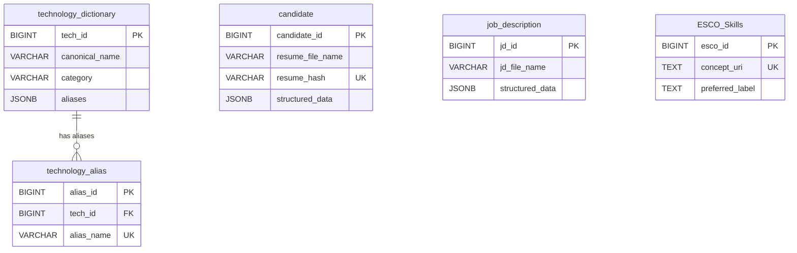

# RankResume DB_Store Technical Documentation

## 1. DB_Store Phase Overview

`DB_Store` is the RankResume ingestion and persistence phase. It converts resume and job-description files into searchable text and validated structured JSON, then stores the results in PostgreSQL for later ATS, ranking, and interview-related modules.

The phase solves the problem of turning heterogeneous source documents into a repeatable database representation. Its inputs are files in `Data/resumes/` and `Data/jds/`; its outputs are rows in PostgreSQL and exported `Data/resumes.json` and `Data/jds.json` datasets.

```text
Resume / JD files
        |
        v
File detection
        |
        v
Local text extraction
        |
        v
Whitespace cleaning and NLP preprocessing
        |
        v
Contact, section, education, project, experience, certificate,
job-title, requirement, and skill extraction
        |
        v
Validated structured JSON
        |
        v
PostgreSQL JSONB and text storage
        |
        v
Future ATS / ranking / interview modules
```

The current pipeline does not calculate ATS scores, rank candidates, match resumes to JDs, or generate interview content. The `ats_score` and `final_score` columns exist for later use but are not populated by `process_batch`.

## 2. What Data We Take

### Resume Data

Resume files are read from `Data/resumes/` and support `.pdf`, `.docx`, and legacy `.doc`. The pipeline extracts:

- raw document text;
- candidate name, email, and phone using regular expressions and first-line heuristics;
- skills from the skills section or full resume text;
- education records with degree and mark/CGPA text;
- project titles and descriptions;
- selected experience lines, associated skills, and an initially empty duration;
- certificates and achievement-like entries.

The parsed content is stored in `candidate.structured_data` as JSONB, while both the original extracted text and a cleaned text form are stored separately.

### Job Description Data

JDs are read from `Data/jds/` and support `.pdf`, `.docx`, `.doc`, `.csv`, and `.json`. The pipeline extracts a job title, expected skills, education requirements and academic marks, experience requirements, and certificate-related lines. The result is stored in `job_description.structured_data` as JSONB.

### Technology / Skill Vocabulary

The project has a controlled vocabulary seeded from the `TECHNOLOGIES` and `CONTROLLED_SKILLS` constants. Examples include Java, Python, React.js, PostgreSQL, Git, Docker, REST API, unit testing, algorithms, agile, and scrum. Entries have a canonical name, category, and aliases.

ESCO is separate reference data. It is not a replacement for `technology_dictionary`, and the current pipeline does not use ESCO to calculate rankings. ESCO labels and alternative labels are loaded into memory so extracted skills can be normalized when they match an ESCO label.

## 3. Input Data Flow

```text
File in Data/resumes or Data/jds
        |
        v
Extension filter
        |
        v
PDF/DOCX/DOC reader, or CSV/JSON JD reader
        |
        v
Raw text and optional source job title
        |
        v
Whitespace normalization and protected-vocabulary cleaning
        |
        v
Parser-specific structured extraction
        |
        v
Schema validation
        |
        v
INSERT into PostgreSQL, or skip an existing document
```

- **PDF:** `pdfplumber` extracts text page by page.
- **DOCX:** `python-docx` reads paragraphs and table cells.
- **DOC:** the pipeline uses local `antiword`, or headless LibreOffice/`soffice` as a fallback. It does not upload DOC files externally.
- **CSV JD:** `csv.DictReader` reads rows, preserves non-empty key/value pairs as text, and searches title-like column names (`job title`, `title`, `position`, `designation`).
- **JSON JD:** JSON is recursively walked; scalar values become labelled text and title-like keys provide the job title.

Unsupported files are excluded by the extension filters and are counted as unsupported only if handled by a caller that reports such files. A parse or validation failure rolls back that document and does not stop the remaining batch.

## 4. Resume Processing

### 4.1 Text Extraction

`extract_text()` dispatches by suffix. `extract_pdf()` joins extracted page text; `extract_docx()` combines non-empty paragraphs and table rows; `extract_doc()` invokes a local command-line reader. The resulting string is the resume's raw text.

### 4.2 Raw Text

Raw text is retained in `candidate.raw_text` so that parsing decisions can be audited, parsers can be improved, and documents can be reprocessed without losing the original extraction result.

### 4.3 Cleaning / NLP Processing

`clean_text()` performs the implemented preprocessing:

1. normalizes non-breaking spaces, line endings, and repeated whitespace;
2. temporarily protects known technology and controlled-skill terms;
3. lowercases text and replaces punctuation with spaces;
4. removes the configured stopword set;
5. restores protected terms and normalizes spacing.

Skill discovery combines exact vocabulary/alias matching with the external `skill-extractor` package, then applies canonical aliases, ESCO labels, ignored-phrase filtering, and duplicate removal. This is rule-based extraction plus the installed skill extractor; no embedding model or neural named-entity model is implemented here.

### 4.4 Information Extraction

- **Candidate name, email, phone:** email and phone use regular expressions; the name is selected from plausible non-numeric lines among the first five non-empty lines.
- **Sections:** headings are mapped through `SECTION_ALIASES` to skills, education, projects, experience, certifications, or other text.
- **Education:** degree-like patterns such as bachelor, master, diploma, MCA, BCA, 10th, and 12th are detected; nearby percentage/CGPA/GPA/SGPA text becomes `mark`.
- **Projects:** title-like lines start records and following lines become a normalized description. Metadata such as role, duration, team size, tech stack, and URLs is excluded.
- **Experience:** qualifying non-bullet, short lines become records with `job_role`, extracted `skills`, and an empty `duration`.
- **Certificates:** explicit certification lines and achievement markers such as awards, prizes, medals, and hackathons are collected into one `certificate` list.

### 4.5 Structured Resume JSON

The validator requires exactly these top-level keys and list values:

```json
{
  "skill": [],
  "education": [
    {
      "degree": "",
      "mark": ""
    }
  ],
  "project": [
    {
      "project_title": "",
      "description": ""
    }
  ],
  "experience": [
    {
      "job_role": "",
      "skills": [],
      "duration": ""
    }
  ],
  "certificate": []
}
```

All string values are lowercased by the parser before storage. Empty lists are valid when a source resume has no detectable section.

## 5. Job Description Processing

`extract_jd_text()` reads document formats through `extract_text()` and reads CSV/JSON as structured source data. The title is taken from a title-like CSV/JSON field when available, otherwise `extract_job_title()` searches labelled lines and then the first plausible heading.

JD preprocessing keeps likely skill-bearing content, includes requirement/responsibility sections, and excludes education text and administrative sections such as salary, location, benefits, company overview, and interview process. `parse_jd()` then extracts controlled/external skills, degree text, academic percentage/marks, experience ranges such as `1-3 years`, and lines containing certification terms.

The validated JD JSON schema is:

```json
{
  "job_title": "",
  "expected_skills": [],
  "expected_education": [
    {
      "degree": "",
      "percentage/mark": ""
    }
  ],
  "expected_experience": [
    {
      "skill": [],
      "years": ""
    }
  ],
  "expected_certificate": []
}
```

The validator requires exactly these five keys. Academic percentages are stored separately from degree text; unrelated percentages such as performance or growth percentages are excluded by context rules.

## 6. PostgreSQL Database

PostgreSQL is the persistent store for the normalized document corpus, source text, parser output, and reusable skill vocabularies. It allows later RankResume modules to query structured fields while retaining the source and cleaned text needed for auditing or reprocessing.

```text
Database: rankresume
DBMS: PostgreSQL
Host: localhost (default; RANKRESUME_DB_HOST can override it)
Port: 5432 (default; RANKRESUME_DB_PORT can override it)
```

The password is read from `RANKRESUME_DB_PASSWORD` and is intentionally not documented here. `connect_db()` verifies that the connection is to `rankresume` and refuses template or other databases.

## 7. Database Schema

The runtime `create_schema()` and shareable `database_setup.sql` define these five tables. `database_setup.sql` contains schema/reference data and intentionally excludes candidate and job-description row data.

| Table | Purpose | Primary key | Important data and constraints |
| --- | --- | --- | --- |
| `candidate` | Processed resume and candidate data | `candidate_id BIGSERIAL` | Contact fields, source filename, unique `resume_hash`, raw/clean text, `structured_data JSONB`, score placeholders, timestamp |
| `job_description` | Processed JD data | `jd_id BIGSERIAL` | Title, source filename, raw/clean text, `structured_data JSONB`, timestamp |
| `technology_dictionary` | Project-controlled vocabulary | `tech_id BIGSERIAL` | `canonical_name VARCHAR(100)`, category, `aliases JSONB`, timestamp; canonical name is indexed but not declared unique |
| `technology_alias` | Alias-to-controlled-term mapping | `alias_id BIGSERIAL` | `tech_id BIGINT` foreign key, unique `alias_name`; cascade delete follows its technology |
| `ESCO_Skills` | Imported ESCO reference vocabulary | `esco_id BIGSERIAL` | Unique `concept_uri`, labels, classifications, status, timestamp, scope note |

There are no foreign keys from `candidate` or `job_description` to skill tables. Skills are embedded in each document's JSONB; the vocabulary tables are independent/reference tables.

## 8. Candidate Table

| Column | Type | Storage behavior |
| --- | --- | --- |
| `candidate_id` | `BIGSERIAL PRIMARY KEY` | Generated database identity |
| `candidate_name` | `VARCHAR(150)` | Parsed first-name heuristic; nullable |
| `email` | `VARCHAR(150)` | Regex result; nullable |
| `phone` | `VARCHAR(30)` | Regex result; nullable |
| `resume_file_name` | `VARCHAR(255)` | Original source filename |
| `resume_hash` | `VARCHAR(64) UNIQUE` | SHA-256 of file bytes |
| `raw_text` | `TEXT` | Text extracted from the source file |
| `clean_text` | `TEXT` | Normalized and stopword-filtered text |
| `structured_data` | `JSONB` | Validated resume JSON |
| `ats_score` | `FLOAT` | Schema placeholder; not populated by DB_Store |
| `final_score` | `FLOAT` | Schema placeholder; not populated by DB_Store |
| `created_at` | `TIMESTAMP DEFAULT CURRENT_TIMESTAMP` | Insert time |

New batch ingestion populates every field except `ats_score` and `final_score`.

## 9. Job Description Table

| Column | Type | Storage behavior |
| --- | --- | --- |
| `jd_id` | `BIGSERIAL PRIMARY KEY` | Generated database identity |
| `job_title` | `VARCHAR(150)` | Extracted or source-provided title, truncated to 150 characters on insert |
| `jd_file_name` | `VARCHAR(255)` | Original source filename |
| `raw_text` | `TEXT` | Extracted/serialized field text from the JD input |
| `clean_text` | `TEXT` | Output of the same vocabulary-protecting cleaner |
| `structured_data` | `JSONB` | Validated JD JSON |
| `created_at` | `TIMESTAMP DEFAULT CURRENT_TIMESTAMP` | Insert time |

The table has no JD hash, score, or foreign-key column in the implemented schema.

## 10. Technology and Technology Alias Tables

`technology_dictionary` is the project's controlled vocabulary. Each seeded entry has a canonical name, a category such as `programming_language`, `framework`, `database`, `tool`, or `soft_skill`, and a JSONB array of aliases. The pipeline loads this table before matching text, so values such as `js` can normalize to `javascript` and `reactjs` to `react.js`.

`technology_alias` stores each canonical name and its aliases as rows connected to `technology_dictionary.tech_id`. `alias_name` is unique, and `ON CONFLICT DO NOTHING` prevents duplicate alias rows during reseeding. The dictionary's `aliases` JSONB and the alias table therefore provide two stored views of the same controlled mapping.

Example implemented mapping:

```text
js / JavaScript
        |
        v
JavaScript
```

The seed operation uses `ON CONFLICT DO NOTHING` for dictionary entries, but `canonical_name` itself is not declared unique in the schema. Existing duplicate canonical rows are therefore not automatically merged.

## 11. ESCO_Skills

ESCO is an external European Skills, Competences, Qualifications and Occupations reference vocabulary. The pipeline locates a CSV named like `skills*.csv` under `/home/vedant-2506/Downloads` by default, or uses `ESCO_SKILLS_CSV` when configured. It requires the ESCO columns `conceptType`, `conceptUri`, `skillType`, `reuseLevel`, `preferredLabel`, `altLabels`, `hiddenLabels`, `status`, `modifiedDate`, and `scopeNote`.

The importer deduplicates input rows by `conceptUri`, deletes rows with null URIs, and upserts rows on the unique `concept_uri` constraint. The table stores `esco_id`, URI, concept/skill classifications, reuse level, preferred/alternative/hidden labels, status, modification date, and scope note. The validated notebook run imported 13,939 ESCO records.

ESCO labels are loaded into an in-memory alias map for normalization. ESCO is separate from the project's `technology_dictionary` and is not currently used to rank candidates or match candidates to jobs.

## 12. Database Storage Process

```text
Input file
   |
   v
Filename check
   |
   v
SHA-256 (resume) / text extraction
   |
   v
Parse and validate structured JSON
   |
   v
INSERT into candidate or job_description
   |
   v
Commit that document
```

At batch start, the pipeline creates the schema if necessary, optionally resets the five tables when explicitly requested, seeds the controlled vocabulary, imports ESCO, and loads vocabulary labels. Each document is processed inside a cursor block. A successful document is committed immediately; an exception rolls back that document, logs the failure, and continues with the next file. The database connection is closed by the command-line entry point in a `finally` block.

`reprocess_existing_documents()` is an explicit update path for selected filenames. It re-extracts and validates a chosen resume or JD, updates its raw/clean/structured fields, commits the group, and exports datasets again.

## 13. Duplicate / Idempotent Ingestion

For both resumes and JDs, `filename_exists()` compares a whitespace-normalized, case-folded filename against the relevant table before extraction. A matching filename is skipped, so rerunning the batch does not reinsert the same source filename.

Resume bytes are also hashed with SHA-256 and stored in the unique `candidate.resume_hash` column. This protects against inserting identical file content under a different filename, although the current batch code does not proactively query the hash: such a conflict becomes a rolled-back failed insert. JDs have no hash column and use filename checking only.

The normal batch path is therefore incremental and filename-idempotent, not a full source-to-database synchronization: source files removed from `Data/` are not deleted from PostgreSQL. `reset=True` is destructive and drops the five managed tables before recreating them; the notebook deliberately runs with `reset=False`.

## 14. Database Relationships



`candidate`, `job_description`, and `ESCO_Skills` have no direct foreign-key relationship to one another or to the technology tables. Document skills are stored inside JSONB rather than in a join table.

## 15. DB_Store Folder Structure

```text
DB_Store/
├── database_setup.sql
├── rankresume_pipeline.py
├── rankresume_pipeline.ipynb
└── DB_Store_info.md
```

- `rankresume_pipeline.py`: authoritative modular implementation for extraction, cleaning, parsing, validation, schema creation, vocabulary seeding, ESCO import, ingestion, reprocessing, and dataset export.
- `rankresume_pipeline.ipynb`: executable walkthrough that imports the module, verifies readers and input folders, prepares PostgreSQL, runs the batch, prints representative outputs, and validates real resume/JD parsing and stored JSONB.
- `database_setup.sql`: shareable PostgreSQL schema and reference-data dump. Candidate and JD rows are intentionally excluded from this export.
- `DB_Store_info.md`: this technical description.

The adjacent `Data/` folder contains the source directories, exported JSON datasets, and runtime log directory. The validated repository state contained 69 supported resume files and 25 supported JD files.

## 16. Technologies and Libraries Used

| Technology | Purpose |
| --- | --- |
| Python | Pipeline implementation and parsing rules |
| PostgreSQL | Persistent document and vocabulary storage |
| `psycopg2` / `psycopg2-binary` | PostgreSQL connection, JSONB adaptation, batch ESCO upsert |
| `pdfplumber` | PDF text extraction |
| `python-docx` | DOCX paragraphs and table extraction |
| `antiword` or LibreOffice | Optional local legacy DOC extraction |
| `skill-extractor` | External skill candidate extraction |
| JSON / JSONB | Structured parser output and vocabulary aliases |
| ESCO CSV | External reference skill vocabulary |

The Python standard library provides CSV/JSON parsing, regular expressions, hashing, logging, filesystem handling, and subprocess-based DOC support.

## 17. Current DB_Store Output

After a successful run:

```text
Resume
  -> extracted raw text
  -> cleaned text
  -> candidate contacts
  -> validated structured resume JSON
  -> candidate row in PostgreSQL

JD
  -> extracted/constructed raw text
  -> cleaned text
  -> validated structured JD JSON
  -> job_description row in PostgreSQL

Technology vocabulary
  -> canonical names, categories, and aliases in reference tables

ESCO
  -> imported reference skills and labels in ESCO_Skills

Database rows
  -> exported to Data/resumes.json and Data/jds.json
```

The notebook's recorded validation state shows 69 candidate rows, 25 job-description rows, 13,939 ESCO rows, and valid JSON for all 69 real resumes and 25 real JDs.

## 18. What Is NOT Part of DB_Store

DB_Store currently includes:

- file discovery and local text extraction;
- text cleaning and implemented NLP/rule-based preprocessing;
- contact, section, education, project, experience, certificate, title, and requirement extraction;
- skill normalization against project and ESCO vocabularies;
- structured JSON validation;
- PostgreSQL storage, controlled reprocessing, and dataset export.

The following are outside the implemented DB_Store phase and are **Planned / Future Work** unless implemented elsewhere in the project:

- ATS score calculation;
- candidate-to-JD matching and ranking;
- interview question generation;
- answer evaluation;
- AI interview or exam detection.

## 19. Current Status

**Status: Completed for the implemented ingestion scope; later ranking functionality remains Planned / Future Work.**

The repository contains a working Python pipeline and notebook validation flow. The schema, controlled vocabulary, ESCO import, supported file readers, resume/JD parsers, JSON validators, incremental batch ingestion, controlled reprocessing, and exports are implemented. Score columns are present but unused, and matching/ranking is explicitly outside the notebook's stated scope.

## 20. Important Design Decisions

- **PostgreSQL:** provides durable storage for source text, parsed JSONB, and reusable reference vocabularies in the RankResume pipeline.
- **JSONB:** preserves variable resume/JD structures while allowing structured downstream access without a large set of document-specific relational tables.
- **Raw plus clean text:** raw text preserves evidence; clean text supports normalized downstream search and analysis.
- **SHA-256 for resumes:** records file identity and adds a database-level duplicate guard through the unique `resume_hash` constraint.
- **Filename checks:** make ordinary batch reruns incremental and avoid repeating extraction for already-ingested source files.
- **Controlled technology vocabulary:** gives project-defined canonical skill names and aliases for consistent extraction.
- **Separate ESCO storage:** keeps the external/reference vocabulary distinct from project-controlled technology terms while making labels available for future normalization and matching.
- **Per-document transactions:** isolate bad files so a parse, extraction, or database error rolls back only that document and does not discard successful earlier inserts.

### Verification Record

Documentation was based on the complete DB_Store Python module, notebook source and recorded validation outputs, schema SQL, exported resume/JD JSON, and the `Data/resumes/` and `Data/jds/` folder contents. No passwords or credentials are included.